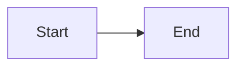

---
# Copy this file to blog/<topic>/<sub-topic>/_posts/YYYY-MM-DD-post-name.md
title: "Post title"
description: "One or two sentences. Shown under the title, on the blog index and in link previews."
tags: [Tag one, Tag two]
# image: /assets/blog/post-name/cover.png   # optional: link-preview image (1200×630)
---

Opening paragraph.

## First section

Text, `inline code`, **bold**, [a link](https://example.com).

*Optional caption.*

