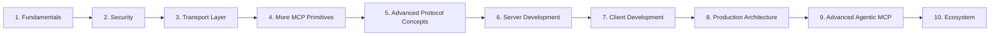

This is the index for the MCP series. It is split into ten parts, from the fundamentals to the wider ecosystem. Each topic links to its own post once that post is published.

| Part | Area | Topics |
|---|---|---|
| 1 | [Fundamentals](#part-1) | 8 |
| 2 | [Security](#part-2) | 9 |
| 3 | [Transport Layer](#part-3) | 7 |
| 4 | [More MCP Primitives](#part-4) | 8 |
| 5 | [Advanced Protocol Concepts](#part-5) | 9 |
| 6 | [MCP Server Development](#part-6) | 8 |
| 7 | [MCP Client Development](#part-7) | 7 |
| 8 | [Production MCP Architecture](#part-8) | 10 |
| 9 | [Advanced Agentic MCP](#part-9) | 8 |
| 10 | [Ecosystem](#part-10) | 6 |

---

## 1. Fundamentals {#part-1}

1. What is MCP
2. MCP Architecture and Components
3. Host vs Client vs Server
4. MCP Lifecycle
    - Old vs new
5. JSON-RPC 2.0 Fundamentals
6. MCP Protocol Messages
7. Simplest MCP Possible and Integrate with Claude Code / Claude / ChatGPT locally
8. Write a Simplest MCP Client

## 2. Security {#part-2}

1. OAuth 2.1 for MCP
2. Authorization Server and Resource Server
3. PKCE
4. Dynamic Client Registration
5. Protected Resource Metadata
6. Token Validation
7. Scopes and Permissions
8. Token Forwarding and the Confused Deputy Problem
9. MCP Security Best Practices

## 3. Transport Layer {#part-3}

1. STDIO Transport
2. Streamable HTTP
3. SSE and Legacy HTTP+SSE
4. Session Management
5. Stateless vs Stateful MCP Servers
6. Reconnection and Resumability
7. Message Framing

## 4. More MCP Primitives {#part-4}

> **MCP Capabilities and Negotiation**

1. Tools
2. Resources
3. Prompts
4. Sampling
5. Roots
6. Elicitation
7. Logging
8. Notifications

## 5. Advanced Protocol Concepts {#part-5}

1. Sampling with Tools
2. Elicitation Workflows
3. Tasks and Asynchronous Operations
4. Progress Notifications
5. Cancellation
6. Pagination
7. Completion Capabilities
8. Structured Tool Outputs
9. Error Handling

## 6. MCP Server Development {#part-6}

1. Building Servers Using Python
2. Tool Discovery and Registration
3. Resource Templates
4. Dynamic Tool Execution
5. External API Integration
6. Middleware and Interceptors
7. Connection Management
8. Testing MCP Servers

## 7. MCP Client Development {#part-7}

1. Connecting to Multiple MCP Servers
2. Discovering Tools Dynamically
3. Tool Execution Lifecycle
4. Managing Multiple Server Sessions / Connection Management
5. Client-side Tool Filtering
6. Handling Server Failures
7. Context Management

## 8. Production MCP Architecture {#part-8}

1. MCP Gateway
2. Multi-tenant MCP Servers
3. Authentication and Authorization
4. Rate Limiting
5. Observability and Tracing
6. Audit Logging
7. Tool Execution Sandboxing
8. Secrets Management
9. Horizontal Scaling
10. High Availability

## 9. Advanced Agentic MCP {#part-9}

1. MCP with Claude Code
2. MCP with LangGraph
3. MCP with Multi-agent Systems
4. MCP Tool Orchestration
5. Agent-to-MCP Communication
6. MCP Server Composition
7. Tool Selection and Routing
8. Human-in-the-loop Workflows

## 10. Ecosystem {#part-10}

1. MCP Registry
2. Remote MCP Servers
3. MCP Apps
4. MCP Gateway Implementations
5. MCP SDK Internals
6. MCP Specification Evolution

---

<!-- To link a post: 1. [What is MCP](/blog/agents/mcp/what-is-mcp/) -->
