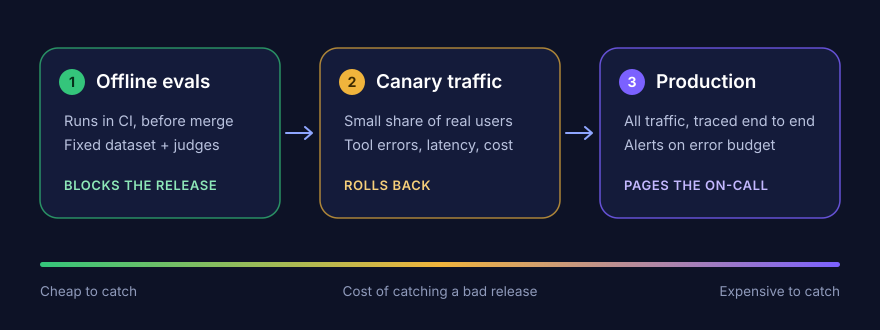
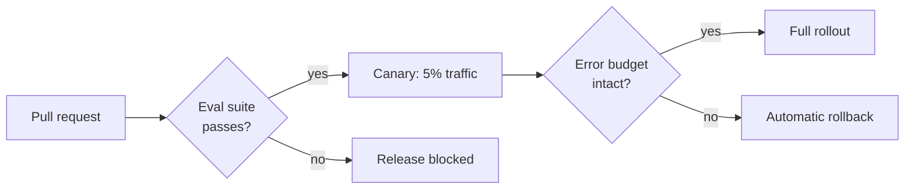
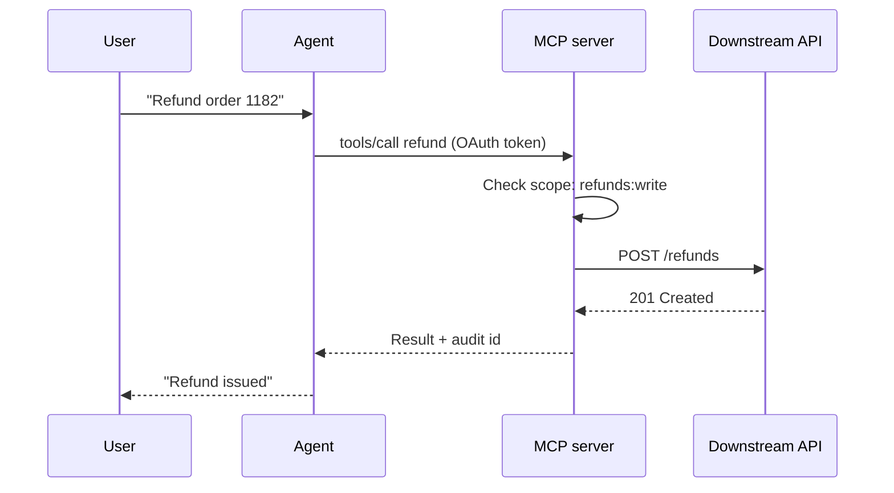

This is a sample post. It exists to show everything a post on this blog can contain, so the source file — `blog/agents/reliability/_posts/2026-11-10-hello-world.md` — works as a cheat sheet. Delete it once the first real post is up.

## Text

Paragraphs are plain text separated by a blank line. You get **bold**, *italic*, `inline code` and [links](https://jatin-mishra.github.io/) with the usual Markdown syntax.

Lists work as expected:

- Idempotency keys on every write path
- Backpressure before autoscaling
- Timeouts that are shorter than the caller's timeout

Numbered lists too:

1. Reproduce the failure
2. Write the test that catches it
3. Fix it, and keep the test

> Blockquotes are styled as callouts. Use them for the one thing a skimming reader should not miss.

## Code

Fenced code blocks are syntax-highlighted at build time — name the language after the opening fence.

```python
from dataclasses import dataclass


@dataclass
class Verdict:
    case_id: str
    score: float  # 0.0 – 1.0, from the judge


def release_gate(verdicts: list[Verdict], threshold: float = 0.85) -> bool:
    """Block the release if the eval suite's pass rate drops below the bar."""
    passed = sum(v.score >= threshold for v in verdicts)
    pass_rate = passed / len(verdicts)
    print(f"{passed}/{len(verdicts)} cases passed ({pass_rate:.0%})")
    return pass_rate >= 0.95
```

```sql
-- Take the row lock first, then check stock: no lost updates.
SELECT quantity FROM inventory WHERE sku_id = 42 FOR UPDATE;
UPDATE inventory SET quantity = quantity - 1 WHERE sku_id = 42;
```

## Images

Put image files in `assets/blog/<post-name>/` and reference them with an absolute path. A line of italic text directly under an image becomes its caption.


*An SVG exported from a drawing tool. PNG and JPG files work the same way.*

## Diagrams

A code block tagged `mermaid` is rendered as a diagram in the browser, so diagrams live in the post as text and show up in diffs.



Sequence diagrams are handy for request flows:



## Tables

| Signal | Where it is measured | Typical action |
| --- | --- | --- |
| Eval pass rate | CI, before merge | Block the release |
| Tool-call error rate | Canary traffic | Roll back |
| p95 latency | Production | Page the on-call |

## Publishing

The folder a post lives in is its URL. This file sits in `blog/agents/reliability/_posts/`, so it is served at `/blog/agents/reliability/hello-world/`.

1. Pick the topic folder and add a file named `YYYY-MM-DD-your-title.md` to its `_posts/` folder.
2. Fill in the title, description and tags at the top.
3. Commit and push to `main`. GitHub Pages rebuilds the site, and the post appears under its topic a minute or so later.
